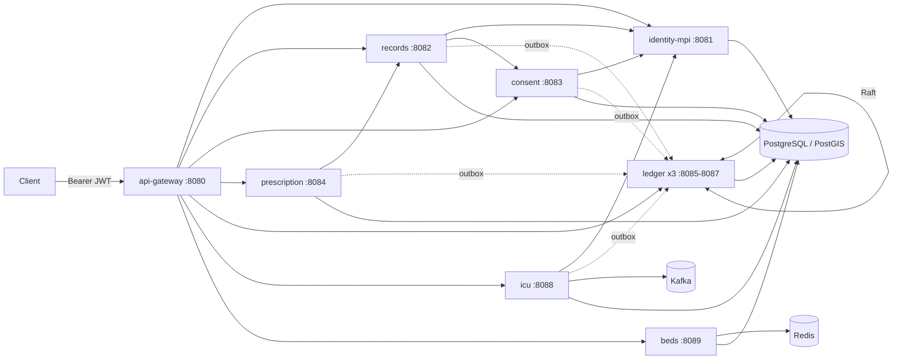

# MediGraph

A backend for sharing health records between hospitals. Java 21, Spring Boot 3.3, eight services behind a gateway,
PostgreSQL for storage.

The problem I wanted to work on: two hospitals that have never shared a database need to agree they're looking at
the same patient, the second one should only see records the patient has consented to, and anyone should be able
to check later that a record wasn't changed after it was written. Prescription checks, ICU early-warning scores
(NEWS2) and a nearest-free-ICU-bed lookup got added along the way.

Patient matching, the ledger, Raft, the tries etc. are written by hand on purpose, that was the point of the
project. Kafka, Redis and PostGIS each sit behind an interface with a plain in-process/JDBC fallback, so
`mvn install` runs the whole test suite on embedded Postgres without Docker.

Not a medical device. The drug, interaction, allergy and NEWS2 data is a small hand-made sample.

## Services



```
api-gateway      :8080  routing, rate limiting, circuit breakers, dev token issuer + JWKS
identity-mpi     :8081  Health IDs, registration, master patient index, review queue for unsure matches
records          :8082  encrypted records, consent-filtered reads, integrity check, erasure, key rotation
consent          :8083  signed consent grants/revocations, break-glass, access decisions
prescription     :8084  drug search with typo correction, interaction and allergy checks
ledger (x3)      :8085-8087  Raft-replicated hash chain of Merkle blocks, inclusion proofs
icu              :8088  vitals ingest, NEWS2 per event-time window, alerts
beds             :8089  nearest hospitals with a free ICU bed, short TTL holds
```

Each service has its own schema. The algorithms live in plain library modules (`medigraph-mpi`, `-ledger`,
`-crypto`, `-consent`, `-prescription`, `-icu`, `-beds`, `-common`) and the shared Spring setup is in
`medigraph-platform` (resource server, errors, correlation ids, outbox relay, idempotency, HTTP clients).

Every service uses the same layout, checked by ArchUnit in `medigraph-arch-rules`:

```
com.medigraph.service.<svc>
├── domain            no Spring/JPA/Jackson
├── application       use cases, talks to the outside only through port.out
│   └── port.out
├── adapter.in.web
├── adapter.out.*     JDBC, HTTP, Redis, PostGIS, Kafka
└── config
```

More in [docs/architecture.md](docs/architecture.md) and [docs/adr](docs/adr).

## Running it

JDK 21 and Maven 3.9. Docker for the infra and the container tests.

What I actually run: infra in Docker, services as normal JVMs.

```bash
mvn -DskipTests install
scripts/local/start.sh all        # postgis :55432, redis :6379, kafka :9092, then the services on 8080-8089
scripts/local/demo.sh --fresh     # wipes local data and runs the full scenario through the gateway
scripts/local/start.sh stopall
```

`demo.sh` needs Python 3 with `requests`. It writes every request/response to `demo-output.txt` and a
readable version to `patient-journey.md`. A captured run is in [docs/patient-journey.md](docs/patient-journey.md):
registration and matching, consent, an encrypted record and its Merkle proof, killing the ledger leader,
break-glass from another hospital, an interaction alert after a typo fix, a NEWS2 alert, nearest ICU bed and a
race for the last one, crypto-shredding, and a couple of 401/403s.

There's also a `docker compose up --build -d` that runs everything in containers, but I haven't got the app
containers talking to each other on my machine yet (bridge network timeouts), so treat that path as untested.

Postman: import the collection and environment from [docs/postman](docs/postman) and run it top to bottom.
The first folder gets dev tokens and later requests reuse the ids it saves. From the CLI:

```bash
npx newman run docs/postman/MediGraph.postman_collection.json -e docs/postman/MediGraph.local.postman_environment.json
```

Each service has Swagger at `/swagger-ui.html`, metrics at `/actuator/prometheus` and health probes under
`/actuator/health`.

## Security notes

- Every service checks the RS256 JWT itself (issuer, audience, expiry), not just the gateway. Roles are DOCTOR,
  NURSE, RECEPTION, PATIENT, STEWARD, ADMIN and SERVICE. Reading patient data also needs consent or a matching
  role/facility rule.
- Service-to-service calls use client-credentials tokens with the SERVICE role. The gateway blocks `/internal/**`
  from outside.
- The dev token issuer (`GATEWAY_DEV_ISSUER=true`) will mint any role and its key changes on restart. Local only.
  For a real setup point `JWK_SET_URI` / `TOKEN_URI` at an actual IdP.
- Records are AES-256-GCM encrypted with a key per patient, and that key is wrapped by a master key from env vars or
  a secrets dir. Rotating the master key rewraps the patient keys without touching the data.
- Only SHA-256 hashes go on the ledger. Consent grants are Ed25519-signed.
- No real secrets in the repo. The compose file and yml defaults have obviously-dev values.

## Reliability

- Outbound calls go through Resilience4j (timeouts, retries for idempotent calls, a breaker per downstream).
  A dead dependency gives the caller a 503 problem response.
- POSTs take an `Idempotency-Key`. Same key + same body returns the stored response, different body is a 422,
  and a duplicate that arrives while the first one is still running gets a 409.
- Events and ledger anchors go through a transactional outbox, relayed with `FOR UPDATE SKIP LOCKED`.
- JSON logs with correlation id and trace id under the `json` profile.

## Tests

346 tests, all passing on the last `mvn install` with Docker running. Five of them are Testcontainers tests for
Kafka Streams, Redis and PostGIS, and they're skipped without Docker. Everything else that needs a database runs
on embedded Postgres (zonky). The ledger (52), ICU (69) and MPI (47) modules have the most coverage.

Single-machine benchmark numbers for the read paths are in [docs/benchmark.md](docs/benchmark.md). The k6 write
scripts in `load/` haven't been run yet.

## Where the algorithms are

- Health ID check digit: Verhoeff (`common/.../id/Verhoeff.java`), catches single-digit typos and adjacent swaps, which Luhn misses
- Finding match candidates: Soundex + birth year / phone blocking keys (`mpi/.../BlockingKeys.java`)
- Name similarity: Jaro-Winkler (`mpi/.../algo/JaroWinkler.java`)
- Match decision: Fellegi-Sunter weights with two thresholds, unsure cases go to a person (`mpi/.../FellegiSunterScorer.java`)
- Duplicate clusters: Union-Find with path halving and union by rank (`mpi/.../algo/UnionFind.java`)
- Tamper evidence: Merkle tree with inclusion proofs + hash chain (`ledger/.../merkle/MerkleTree.java`)
- Replication: Raft with the log in Postgres (`ledger/.../raft/RaftNode.java`)
- Drug autocomplete: trie (`prescription/.../algo/DrugTrie.java`)
- Misspelled drug names: BK-tree over Levenshtein distance (`prescription/.../algo/BkTree.java`)
- Interactions: adjacency-set graph (`prescription/.../InteractionGraph.java`)
- NEWS2 windows: per-patient TreeMap of event-time windows with a watermark (`icu/.../stream/News2WindowEngine.java`)
- Nearest free beds: haversine with a size-k heap after a bounding-box SQL filter (`beds-service/.../JdbcHaversineLocator.java`)
- Bed shards: consistent hash ring with virtual nodes (`beds/.../shard/ConsistentHashRing.java`)
- Last-bed race: compare-and-set on a `version` column (`beds-service/.../JdbcBedRepository.java`)
- Gateway routing: path trie with wildcards; rate limiting: token bucket; caches: LRU (`api-gateway/.../domain/`)

## Why some things are the way they are

- Hashes on the ledger, data in Postgres. A ledger can't forget but patients can ask to be erased. Deleting a
  patient's key makes their records unreadable while the chain still verifies. Lose the key and the data is gone,
  that's intended. (ADR 0002, 0004)
- Raft instead of a blockchain. The participants are known hospitals, so no proof-of-work. Raft only handles
  crashes, not malicious nodes: a bad majority could rewrite history, but a single bad node or someone editing
  the DB directly gets caught by the hash chain. (ADR 0003)
- Ledger writes are batched into one Merkle block per batch. A bit more latency, far fewer consensus rounds.
  Anchors go into the outbox in the same transaction as the record, so a rolled-back write never leaves one behind.
- Matching uses two thresholds instead of one. The m/u probabilities are set by hand for now, learning them with EM
  would be the next step. (ADR 0005) Blocking also means two records sharing no blocking key are never compared.
- Consent is per category. A read returns what's allowed and lists the rest as `withheld` instead of failing.
- Beds use optimistic locking and holds expire on a TTL, so an abandoned booking frees itself.
- NEWS2 uses event time because monitors buffer and resend. Readings that arrive too late are counted and dropped,
  and a cooldown stops repeat alerts.

## Known gaps

- app containers in compose haven't run end to end (see above)
- Raft has no snapshots, log compaction, membership changes or pre-vote, so the term bumps a few times on startup
- if the gateway is down, services can't fetch the JWKS and return 500 instead of 401
- Spring's own 400s (bad JSON etc.) don't include the correlation id yet
- gateway rate limits are in memory per instance
- in beds, the outbox event and the Redis hold aren't atomic, and all shards share one DB
- ICU access is role-based, not consent-based
- consent's patient lookup cache can be stale until the TTL runs out
- the Vault key provider is a stub, only env and directory work
- the MPI index is in memory and rebuilt at startup, and demographics are stored in plaintext so they can be matched
- outbox events go to the log by default; the Kafka sink exists but nothing consumes it yet

Things I'd like to try later: SD-JWT for sharing a single fact like an allergy, offline sync for clinics with bad
internet, and a small patient app that shows who looked at their records.

## License

MIT
