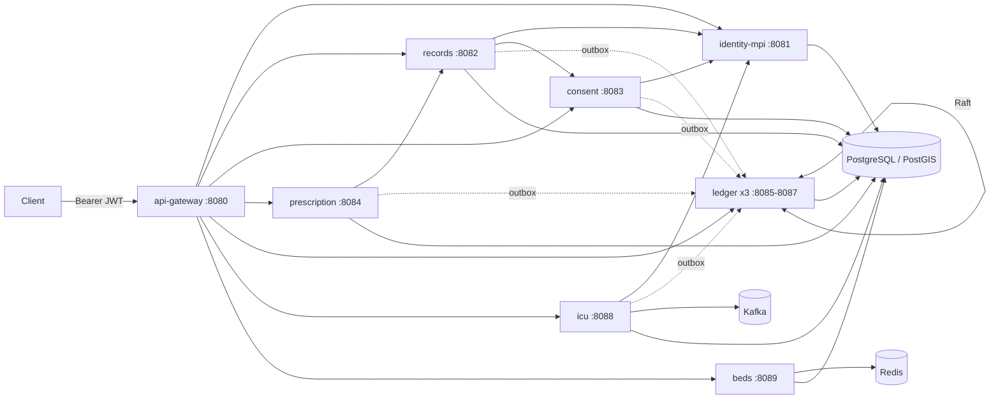

# MediGraph

A backend for exchanging health records between hospitals. It is written in Java 21 and Spring Boot 3.3 and runs as
eight services behind a gateway.

I started it to work through a problem I find interesting: two hospitals that have never shared a database need
to agree that they are looking at the same patient. One of them should only see that patient's records if the
patient has consented, and anyone should be able to check later that a record wasn't edited after it was written.
Along the way it picked up prescription checks, ICU early-warning scores (NEWS2) and a nearest-free-ICU-bed lookup.

The matching, ledger, Raft, tries and so on are my own implementations rather than libraries, because writing
them was the point. Kafka, Redis and PostGIS each sit behind a port that also has a plain in-process or JDBC
adapter, so `mvn install` runs the whole suite on embedded PostgreSQL without Docker.

Not a medical device. The drug, interaction, allergy and NEWS2 data is a small hand-written sample and is not
clinical advice.

## What works and what I haven't checked

| | Status |
|---|---|
| Build, unit tests, ArchUnit rules, Spring Boot tests on embedded PostgreSQL | passing (see [Tests](#tests)) |
| JWT auth with roles, 401/403, problem+json errors, idempotency keys, outbox, gateway routing and rate limits | covered by HTTP-level tests |
| 3-node Raft ledger surviving node restarts, with state in PostgreSQL | `LedgerClusterRecoveryTest` |
| Envelope encryption, KEK rotation, crypto-shredding | `RecordsServiceTest`, `KeyRotationTest` |
| Kafka Streams on a real broker, Redis hold store, PostGIS KNN | Testcontainers tests written, but they skip without Docker and I haven't run them yet |
| `docker-compose.yml` and the Dockerfiles | written, not started yet |
| Throughput and latency | not measured; the k6 scripts in `load/` haven't been run |

## Architecture



| Service | Port | What it does |
|---|---|---|
| api-gateway | 8080 | routing (path trie), per-client token bucket, circuit breakers, dev token issuer + JWKS |
| identity-mpi | 8081 | Health IDs, patient registration, master patient index, steward review queue |
| records | 8082 | encrypted clinical records, consent-filtered reads, integrity check, erasure, KEK rewrap |
| consent | 8083 | signed consent grants/revocations, break-glass access, access decisions for records |
| prescription | 8084 | drug search and spelling correction, interaction and allergy checks |
| ledger (x3) | 8085-8087 | Raft-replicated hash chain of Merkle blocks; inclusion proofs |
| icu | 8088 | vitals ingest, NEWS2 per event-time window, alerts |
| beds | 8089 | nearest-K hospitals with a free ICU bed, short TTL holds |

Each service has its own database (its own schema in the compose setup). The shared libraries hold the algorithms
(`medigraph-mpi`, `-ledger`, `-crypto`, `-consent`, `-prescription`, `-icu`, `-beds`, `-common`) and the Spring
plumbing every service uses (`medigraph-platform`: resource server, error handling, correlation ids, outbox relay,
idempotency, HTTP clients).

Every service uses the same package layout, and `medigraph-arch-rules` checks it with ArchUnit:

```
com.medigraph.service.<svc>
├── domain            no Spring/JPA/Jackson
├── application       use cases; depends on domain and port.out only
│   └── port.out      interfaces for repositories, clients, ledger, clock
├── adapter.in.web    controllers and request/response records
├── adapter.out.*     JDBC, HTTP, Redis, PostGIS, Kafka
└── config            wiring, constructor injection only
```

There's more detail in [docs/architecture.md](docs/architecture.md), and the main decisions are written up in
[docs/adr](docs/adr).

## Running it

You need JDK 21 and Maven 3.9. Docker is only needed for compose and the container tests.

```bash
mvn install                     # build and test; container tests skip without Docker
mvn -DskipTests package         # jars for the Dockerfiles
docker compose up --build -d    # postgres/postgis, kafka, redis, gateway, services, 3 ledger nodes

TOKEN=$(curl -s -XPOST localhost:8080/dev/token -H 'content-type: application/json' \
  -d '{"subject":"dr-1","roles":["DOCTOR"],"facility":"F1"}' | jq -r .access_token)
curl -s "localhost:8080/api/v1/beds/nearest?lat=12.97&lon=77.59" -H "authorization: Bearer $TOKEN"
```

I haven't run the compose stack end to end yet, so expect some rough edges there.

Each service serves OpenAPI at `/v3/api-docs` and `/swagger-ui.html`. Metrics are at `/actuator/prometheus`, and the
liveness and readiness probes are at `/actuator/health/liveness` and `/actuator/health/readiness`.

## Security

- Every service validates RS256 JWTs (issuer, audience, expiry) against the gateway's JWKS, not only the gateway.
  The `roles` claim maps to DOCTOR, NURSE, RECEPTION, PATIENT, STEWARD, ADMIN and SERVICE, and endpoints use
  `@PreAuthorize`. Reading patient data also needs consent or a matching role/facility rule.
- Services call each other with client-credentials tokens carrying the SERVICE role. `/internal/**` needs that
  role, and the gateway refuses `/internal/**` from outside.
- The dev issuer (`GATEWAY_DEV_ISSUER=true`, off by default, on in compose) uses an in-memory RSA key that changes
  on every restart. Its `/dev/token` endpoint will mint any role, so it should never be on outside a laptop. A
  real deployment would point `JWK_SET_URI` and `TOKEN_URI` at an actual IdP.
- Record bodies are AES-256-GCM encrypted under a per-patient data key. That key is wrapped by a KEK from env vars
  (`MEDIGRAPH_KEK_<ID>`, `MEDIGRAPH_KEK_CURRENT`) or a secrets directory. Rotation rewraps data keys without
  touching ciphertext.
- Only SHA-256 hashes go on the ledger. Consent grants are Ed25519-signed with a key kept in a PEM file, so old
  signatures still verify after a restart.
- The repo contains no real secrets. `docker-compose.yml`, `application.yml` defaults and
  `records-service/application-local.yml` have local-dev values (DB password `medigraph-dev`, `dev-only-*`
  client secrets, a dev KEK), and they're labelled as such.

## Reliability bits

- Outbound HTTP goes through Resilience4j: timeouts, retries with backoff for idempotent calls, and one circuit
  breaker per downstream. If a dependency is down the caller gets a `503` problem response.
- POSTs accept an `Idempotency-Key`. A repeat with the same body returns the stored response with
  `Idempotent-Replayed: true`. A different body gets 422, and a duplicate that arrives while the first is still
  running gets 409 with `Retry-After`.
- Events and ledger anchors go through a transactional outbox, relayed with `FOR UPDATE SKIP LOCKED`.
- With the `json` profile (on in compose), logs are one JSON object per line, with the correlation id and trace id.

## Tests

From the last clean `mvn -o install`, on a machine without Docker: **341 run, 336 passed, 5 skipped, 0 failures**.

| Module | Run | Skipped |
|---|---:|---:|
| medigraph-common | 27 | 0 |
| medigraph-crypto | 13 | 0 |
| medigraph-platform | 10 | 0 |
| medigraph-arch-rules | 4 | 0 |
| medigraph-mpi | 47 | 0 |
| medigraph-consent | 9 | 0 |
| medigraph-ledger | 52 | 0 |
| medigraph-prescription | 30 | 0 |
| medigraph-icu | 69 | 1 |
| medigraph-beds | 20 | 0 |
| api-gateway | 16 | 0 |
| identity-mpi-service | 5 | 0 |
| records-service | 6 | 0 |
| consent-service | 7 | 0 |
| prescription-service | 6 | 0 |
| ledger-service | 4 | 0 |
| icu-service | 6 | 0 |
| beds-service | 10 | 4 |

The skipped ones are the Testcontainers tests (`KafkaStreamsVitalsProcessorContainerTest`,
`RedisHoldStoreContainerTest`, `PostgisHospitalLocatorContainerTest`). They use `disabledWithoutDocker = true`.
Anything that needs a database uses embedded PostgreSQL (zonky).

## Algorithms and data structures

| Problem | Approach | Where | Cost |
|---|---|---|---|
| Typos in Health IDs | Verhoeff check digit | `common/.../id/Verhoeff.java` | O(n); catches every single-digit error and adjacent swap, which Luhn doesn't |
| Finding MPI candidates | Soundex + birth-year / phone blocking keys | `mpi/.../BlockingKeys.java` | compare within a block instead of against everyone |
| Name similarity | Jaro-Winkler | `mpi/.../algo/JaroWinkler.java` | O(\|a\|·\|b\|) worst case |
| Match or not | Fellegi-Sunter log-likelihood, two thresholds | `mpi/.../FellegiSunterScorer.java` | O(fields × name length²) per pair; the grey zone goes to a person |
| Duplicate clusters | Union-Find, path halving + union by rank | `mpi/.../algo/UnionFind.java` | amortised O(α(n)) |
| Tamper evidence | Merkle tree, inclusion proofs, hash chain | `ledger/.../merkle/MerkleTree.java` | build O(n), proof O(log n) |
| Replication | Raft, log persisted in PostgreSQL | `ledger/.../raft/RaftNode.java` | append O(k), tick O(peers) |
| Drug type-ahead | Trie | `prescription/.../algo/DrugTrie.java` | O(prefix + results) |
| Misspelled drugs | BK-tree over Levenshtein | `prescription/.../algo/BkTree.java` | triangle inequality prunes most of the tree |
| Interactions | adjacency-set graph | `prescription/.../InteractionGraph.java` | O(k) for k current meds |
| NEWS2 windows | per-patient TreeMap of event-time windows + watermark | `icu/.../stream/News2WindowEngine.java` | O(log W) per reading |
| Nearest free beds | haversine + size-k max-heap, bounding-box SQL prefilter (PostGIS KNN optional) | `beds-service/.../JdbcHaversineLocator.java` | O(n log k) |
| Bed shards | consistent hash ring with virtual nodes | `beds/.../shard/ConsistentHashRing.java` | O(log(N·V)) lookup |
| Last bed race | optimistic compare-and-set on a `version` column | `beds-service/.../JdbcBedRepository.java` | no locks held across requests |
| Gateway routes | segment trie with `*` wildcards | `api-gateway/.../domain/PathTrie.java` | O(segments) |
| Rate limiting | token bucket, lazy refill | `api-gateway/.../domain/TokenBucket.java` | O(1) |
| Bounded caches | LRU on an access-ordered LinkedHashMap | `api-gateway/.../domain/LruCache.java` | O(1) |

## Trade-offs

- **Hashes on the ledger, data in Postgres.** A ledger can't forget, but patients have a right to erasure. With only
  hashes on the chain and one key per patient, deleting the key makes their records unreadable while the chain
  still verifies. The downside is that a lost key means lost data, by design. ([ADR 0002](docs/adr/0002-hashes-only-on-the-ledger.md), [ADR 0004](docs/adr/0004-crypto-shredding.md))
- **Raft rather than a blockchain.** The participants are known hospitals, so there's no need for proof-of-work or BFT.
  Raft is crash-tolerant, not Byzantine-tolerant: a malicious majority could rewrite history. A single bad node or
  someone editing the database gets caught by the hash chain. ([ADR 0003](docs/adr/0003-simplified-raft.md))
- **Batching ledger writes.** Entries are sealed into one Merkle block per batch, which costs some latency but means
  far fewer consensus rounds. Anchors are written to the outbox in the same transaction as the record, so a
  rolled-back write never leaves an anchor behind.
- **Two thresholds for matching**, not one cut-off. The weights come from m/u probabilities, so agreeing on a
  rare birth date counts for more than agreeing on a common city. I set m/u by hand; learning them with EM is
  future work. ([ADR 0005](docs/adr/0005-mpi-matching.md))
- **Blocking misses some pairs.** Two records that share no blocking key are never compared, so a typo in both
  surname and phone gets through.
- **Consent per category.** A read returns what's allowed and lists the rest as `withheld` instead of failing.
- **Optimistic locking for beds.** In the test, 24 clients race for the last bed: one wins and 23 get a 409. Holds
  expire on a TTL, so an abandoned booking frees itself.
- **Event time for NEWS2.** Monitors buffer and resend, so windows are keyed by when a reading was taken. Readings
  past the allowed lateness are counted and dropped, and a cooldown stops repeated alerts.

## Not done yet / known gaps

- The Kafka, Redis and PostGIS adapters have only been exercised by the (skipped) container tests, and compose
  hasn't been started.
- Raft has no snapshots, log compaction, membership changes or pre-vote. The gateway always sends ledger traffic
  to `ledger1`, and followers redirect writes to the leader.
- Rate limits live in each gateway instance's memory. Several replicas would need a shared store.
- The dev issuer's key changes on every restart, so tokens are invalidated.
- In beds, the outbox event and the Redis hold aren't atomic. All shards share one database.
- ICU access is role-based, not consent-based.
- Consent's patient-lookup cache can be stale until its TTL runs out.
- The Vault transit KEK provider is a stub. Only `env` and `directory` work.
- The MPI index is in memory and rebuilt from the database at startup. Demographics are stored in plaintext so
  they can be matched.
- Outbox events go to the log by default. A Kafka sink exists, but nothing consumes the events yet.
- Ideas for later: SD-JWT credentials for sharing a single fact (like an allergy), offline sync for clinics with
  bad connectivity, and a small patient app showing who accessed their records.

## License

MIT, see [LICENSE](LICENSE).
